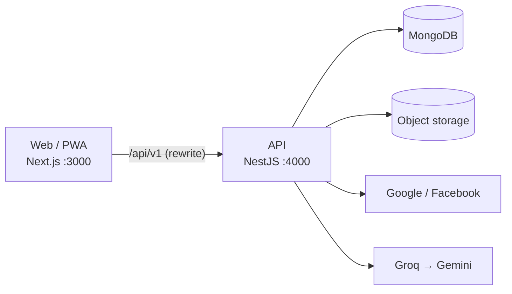

# PalmSight

Web app bói chỉ tay bằng AI: chọn trường phái (phương Tây, phương Đông, Ấn Độ), tích các mục muốn bói, chụp ảnh lòng bàn tay, AI đọc các đường chỉ và trả về một bài bói bằng tiếng Việt. Mỗi lần xem tốn 1 credit. Tài khoản mới được tặng 3 credits; mỗi khi có người nhập mã giới thiệu của bạn, bạn được thêm 2 credits.

Dự án nhỏ của 2 người, làm cho vui.

> **Trạng thái:** giai đoạn thiết kế. Repo hiện chỉ có tài liệu; code sẽ được thêm theo [roadmap](docs/roadmap.md). Các lệnh trong phần [Chạy local](#chạy-local) mô tả cấu trúc dự kiến.

## Tính năng

- Đăng nhập bằng **Google** hoặc **Facebook**, không cần mật khẩu. Hai cách đăng nhập cùng email được gộp thành một tài khoản.
- **Credits**: +3 khi tạo tài khoản, −1 mỗi lần xem, tự hoàn lại nếu AI lỗi hoặc ảnh không phải bàn tay. Credits không hết hạn.
- **Mã giới thiệu**: mỗi tài khoản có một mã 8 ký tự. Người khác nhập mã của bạn (bất cứ lúc nào, một lần) thì bạn được +2 credits ngay.
- **Chọn trường phái bói**: chỉ tay phương Tây, phương Đông (Trung Hoa) hoặc Ấn Độ.
- **Chọn mục bói**: tích từng mục (đường chỉ, gò, tình cảm, sự nghiệp…) hoặc bói toàn bộ. Giá vẫn 1 credit.
- **Chụp ảnh** bằng camera điện thoại (PWA) hoặc tải ảnh có sẵn.
- **Lịch sử** các lần xem và các lần cộng/trừ credits.

## Tech stack

| Lớp | Công nghệ |
| --- | --- |
| Frontend | Next.js, TypeScript, Tailwind CSS, PWA |
| Backend | NestJS (Node 22), Mongoose |
| Dữ liệu | MongoDB 7, S3-compatible storage (Cloudflare R2 / MinIO) |
| Đăng nhập | Google Identity Services, Facebook Login, JWT |
| AI | Groq (model vision, free API key), Gemini làm dự phòng |
| Dev | pnpm workspaces, Docker Compose, ngrok |
| Deploy (free) | Vercel, Render, MongoDB Atlas M0, Cloudflare R2 |

## Kiến trúc



Chi tiết: [docs/README.md](docs/README.md#kiến-trúc-hệ-thống).

## Chạy local

Yêu cầu: Node 22, pnpm 9, Docker, tài khoản ngrok (free), API key Groq (free).

```bash
git clone <repo-url> palmsight && cd palmsight
cp .env.example .env            # điền các key, xem chú thích trong file
pnpm install
docker compose up -d            # MongoDB (replica set) + MinIO
pnpm --filter api db:sync-indexes
pnpm dev                        # web :3000, api :4000
ngrok http 3000 --url=<static-domain>.ngrok-free.app   # khi cần test đăng nhập / điện thoại
```

Hướng dẫn đầy đủ, gồm cách tạo Google OAuth client và Facebook App: [docs/getting-started.md](docs/getting-started.md).

## Cấu trúc thư mục

```text
palmsight/
├─ apps/
│  ├─ web/          # Next.js PWA
│  └─ api/          # NestJS API + Mongoose
├─ packages/
│  └─ shared/       # DTO, enum, trường phái bói, zod schema dùng chung
├─ docs/            # tài liệu thiết kế
├─ .github/         # template issue / PR
├─ docker-compose.yml
└─ .env.example
```

## Tài liệu

| Tài liệu | Nội dung |
| --- | --- |
| [CONTEXT.md](CONTEXT.md) | Bối cảnh, thuật ngữ, quy tắc bất biến — đọc trước khi viết code |
| [docs/README.md](docs/README.md) | Tổng quan, kiến trúc, tech stack |
| [docs/business-rules.md](docs/business-rules.md) | Quy tắc credits và mã giới thiệu |
| [docs/workflow.md](docs/workflow.md) | Luồng đăng nhập, nhập mã, xem bói |
| [docs/database-erd.md](docs/database-erd.md) | Sơ đồ và đặc tả collection MongoDB |
| [docs/api-contract.md](docs/api-contract.md) | Đặc tả REST API |
| [docs/ai-integration.md](docs/ai-integration.md) | Groq, trường phái bói, prompt, schema kết quả |
| [docs/screens.md](docs/screens.md) | Danh sách màn hình và trạng thái |
| [docs/security-privacy.md](docs/security-privacy.md) | Bảo mật, quyền riêng tư ảnh |
| [docs/testing.md](docs/testing.md) | Chiến lược kiểm thử |
| [docs/deployment.md](docs/deployment.md) | Triển khai bằng gói miễn phí |
| [docs/roadmap.md](docs/roadmap.md) | Kế hoạch theo giai đoạn |
| [docs/adr/](docs/adr/README.md) | Các quyết định kiến trúc |

## Đóng góp

Xem [CONTRIBUTING.md](CONTRIBUTING.md). Báo lỗ hổng bảo mật theo [SECURITY.md](SECURITY.md), không mở issue công khai.

## Miễn trừ

Kết quả bói chỉ mang tính giải trí, không thay thế tư vấn y tế, tài chính hay pháp lý.

## License

Chưa có license. Theo mặc định của GitHub, khi repo không có file `LICENSE`, người khác được xem code nhưng không được phép dùng lại.
