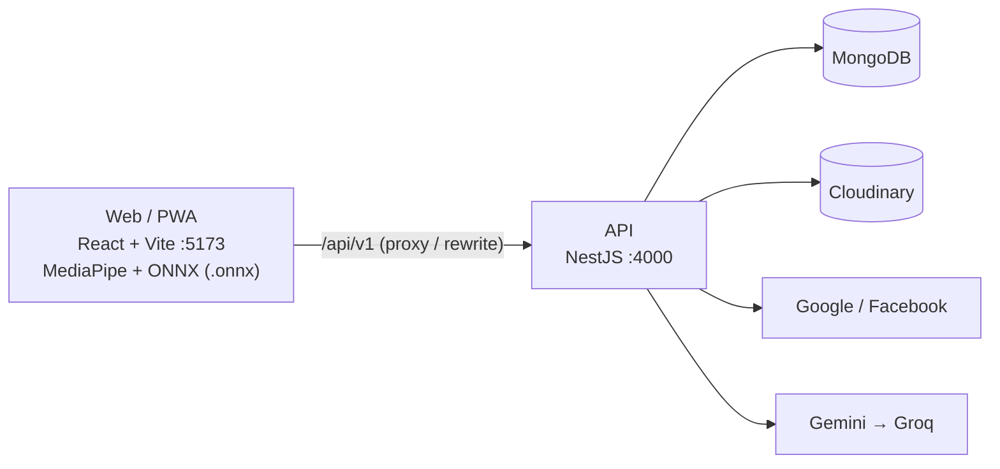

# PalmSight

Web app bói chỉ tay bằng AI: chọn trường phái (phương Tây, phương Đông, Ấn Độ), tích các mục muốn bói, chụp ảnh lòng bàn tay, hệ thống AI thị giác máy tính (`palm_lines.onnx` + MediaPipe + OpenCV/Canvas) tự động cắt vùng lòng bàn tay và vẽ các đường chỉ tay chính (Sinh đạo, Trí đạo, Tâm đạo), đồng thời AI ngôn ngữ (Gemini / Groq) viết bài luận giải chi tiết bằng tiếng Việt. Mỗi lần xem tốn 1 credit. Tài khoản mới được tặng 3 credits; nhập mã giới thiệu của bạn bè được thêm 1 credit; mỗi khi có người nhập mã giới thiệu của bạn, bạn được thêm 2 credits.

Dự án nhỏ của 2 người, làm cho vui.

## Tính năng

- **Đăng ký / đăng nhập** bằng email hoặc username + mật khẩu (xác minh email bắt buộc, có quên mật khẩu), hoặc đăng nhập nhanh bằng **Google** / **Facebook**. Các cách đăng nhập cùng email được gộp thành một tài khoản.
- **Credits**: +3 khi tạo tài khoản, −1 mỗi lần xem, tự hoàn lại nếu AI lỗi hoặc ảnh không phải bàn tay. Credits không hết hạn.
- **Mã giới thiệu**: mỗi tài khoản có một mã 8 ký tự. Người khác nhập mã của bạn (bất cứ lúc nào, một lần) thì bạn được +2 credits, người nhập được +1 credit, cộng ngay.
- **Xoá tài khoản**: không có nút tự xoá; gửi yêu cầu qua email theo hướng dẫn ở `/data-deletion`.
- **Chọn trường phái bói**: chỉ tay phương Tây, phương Đông (Trung Hoa) hoặc Ấn Độ.
- **Chọn mục bói**: tích từng mục (đường chỉ, gò, tình cảm, sự nghiệp…) hoặc bói toàn bộ. Giá vẫn 1 credit.
- **Chụp ảnh & AI Vẽ Chỉ Tay (`.onnx`)**: dùng camera điện thoại (PWA) hoặc tải ảnh có sẵn; tự động tìm tọa độ bàn tay bằng MediaPipe Hands, xoay thẳng & cắt vùng lòng bàn tay bằng OpenCV/Canvas, và chạy mô hình `palm_lines.onnx` để vẽ đè các đường chỉ tay (không cần server Python riêng).
- **Lưu trữ Cloudinary & Lịch sử**: lưu ảnh lòng bàn tay (đã xoá EXIF) và ảnh vẽ chỉ tay trên Cloudinary; xem lại lịch sử các lần xem và lịch sử cộng/trừ credits.

## Tech stack

| Lớp | Công nghệ |
| --- | --- |
| Frontend | React + Vite (SPA), TypeScript, Tailwind CSS, shadcn/ui, PWA |
| AI Vẽ Chỉ Tay | `@mediapipe/tasks-vision` + OpenCV/Canvas Affine + `onnxruntime-web` (`palm_lines.onnx`) |
| Backend | NestJS (Node 22), Mongoose |
| Dữ liệu & Lưu trữ ảnh | MongoDB 7; ảnh tay xoá EXIF bằng `sharp` và lưu trên **Cloudinary** ([ADR-0011](docs/adr/0011-cloudinary-image-storage-and-onnx-palm-lines.md)) |
| Đăng nhập | Email/username + mật khẩu (argon2id), Google Identity Services, Facebook Login, JWT |
| Gửi email | Gmail SMTP qua nodemailer (Mailpit khi dev) |
| AI Luận Giải | Google Gemini (chính), Groq (dự phòng) |
| Dev | pnpm workspaces, Docker Compose, ngrok |
| Deploy (free) | Vercel, Render, MongoDB Atlas M0, Cloudinary Free |

## Kiến trúc



Chi tiết: [docs/README.md](docs/README.md#kiến-trúc-hệ-thống).

## Chạy local

Yêu cầu: Node 22, pnpm 9, Docker, tài khoản ngrok (free), API key Gemini/Groq (free), tài khoản Cloudinary (free).

```bash
git clone <repo-url> palmsight && cd palmsight
cp backend/.env.example backend/.env
cp frontend/.env.example frontend/.env
pnpm install
docker compose up -d
pnpm --filter backend db:sync-indexes
pnpm dev
ngrok http 5173 --url=<static-domain>.ngrok-free.app
```

Hướng dẫn đầy đủ, gồm cách tạo Google OAuth client và Facebook App: [docs/getting-started.md](docs/getting-started.md).

## Cấu trúc thư mục

```text
palmsight/
├─ frontend/        # SPA React + Vite, PWA, ONNX palm lines; .env.example riêng (chỉ biến VITE_*)
├─ backend/         # NestJS API + Mongoose + Cloudinary; .env.example riêng (secret của server)
├─ shared/          # @palmsight/shared: DTO, enum, trường phái bói, Yup schema dùng chung
├─ docs/            # tài liệu thiết kế
├─ .github/         # template issue / PR
└─ docker-compose.yml
```

## Tài liệu

| Tài liệu | Nội dung |
| --- | --- |
| [CONTEXT.md](CONTEXT.md) | Bối cảnh, thuật ngữ, quy tắc bất biến — đọc trước khi viết code |
| [docs/README.md](docs/README.md) | Tổng quan, kiến trúc, tech stack |
| [docs/business-rules.md](docs/business-rules.md) | Quy tắc credits và mã giới thiệu |
| [docs/workflow.md](docs/workflow.md) | Luồng đăng nhập, nhập mã, xem bói & vẽ chỉ tay ONNX |
| [docs/database-erd.md](docs/database-erd.md) | Sơ đồ và đặc tả collection MongoDB |
| [docs/api-contract.md](docs/api-contract.md) | Đặc tả REST API |
| [docs/ai-integration.md](docs/ai-integration.md) | ONNX vẽ chỉ tay, Gemini/Groq, trường phái bói, prompt, schema kết quả |
| [docs/screens.md](docs/screens.md) | Danh sách màn hình và trạng thái |
| [docs/security-privacy.md](docs/security-privacy.md) | Bảo mật, quyền riêng tư và lưu trữ ảnh trên Cloudinary |
| [docs/testing.md](docs/testing.md) | Chiến lược kiểm thử |
| [docs/deployment.md](docs/deployment.md) | Triển khai bằng gói miễn phí |
| [docs/roadmap.md](docs/roadmap.md) | Kế hoạch theo giai đoạn |
| [docs/adr/](docs/adr/README.md) | Các quyết định kiến trúc |

## Đóng góp

Xem [CONTRIBUTING.md](CONTRIBUTING.md). Báo lỗ hổng bảo mật theo [SECURITY.md](SECURITY.md), không mở issue công khai.

## Miễn trừ

Kết quả bói chỉ mang tính giải trí, không thay thế tư vấn y tế, tài chính hay pháp lý.

## License

Chưa có license. Theo mặc định của GitHub, khi repo không có file `LICENSE`, người khác được xem code nhưng không được phép dùng lại.
