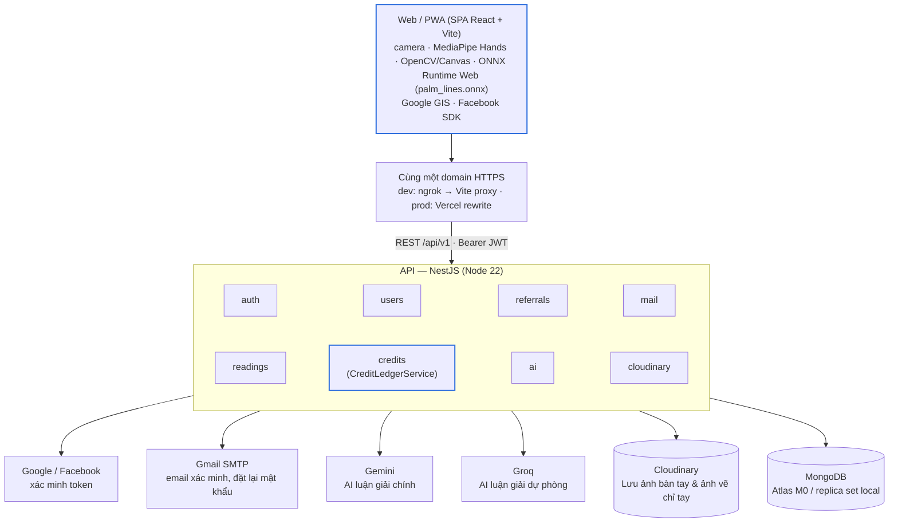

# PalmSight — Tài liệu dự án

Cập nhật: 2026-10-27

Bối cảnh và quy tắc bất biến: [../CONTEXT.md](../CONTEXT.md). Giới thiệu repo: [../README.md](../README.md).

| File | Nội dung |
| --- | --- |
| [business-rules.md](business-rules.md) | Quy tắc credits và mã giới thiệu |
| [workflow.md](workflow.md) | Luồng đăng nhập, nhập mã giới thiệu, xem bói & vẽ chỉ tay bằng ONNX |
| [database-erd.md](database-erd.md) | Sơ đồ quan hệ và đặc tả collection MongoDB |
| [api-contract.md](api-contract.md) | Quy ước API, mã lỗi, request/response từng endpoint |
| [ai-integration.md](ai-integration.md) | Pipeline ONNX vẽ chỉ tay, Gemini/Groq luận giải, các trường phái bói, chọn mục bói, prompt, schema kết quả |
| [screens.md](screens.md) | Màn hình, điều hướng, trạng thái UI |
| [security-privacy.md](security-privacy.md) | Bảo mật, quyền riêng tư và lưu trữ ảnh trên Cloudinary |
| [testing.md](testing.md) | Chiến lược và ca kiểm thử bắt buộc |
| [getting-started.md](getting-started.md) | Cài đặt và chạy local, cấu hình OAuth, ngrok, AI, Cloudinary |
| [deployment.md](deployment.md) | Triển khai bằng các gói miễn phí |
| [roadmap.md](roadmap.md) | Kế hoạch theo giai đoạn |
| [adr/](adr/README.md) | Các quyết định kiến trúc |

## Tổng quan

PalmSight là web app cho người dùng chọn 1 trong 3 trường phái bói (phương Tây, phương Đông, Ấn Độ), tích các mục muốn bói (hoặc bói toàn bộ), chụp ảnh lòng bàn tay, xem trực quan các đường chỉ tay được mô hình AI ONNX vẽ đè trên ảnh và nhận một bài bói chỉ tay chi tiết do AI viết. Mỗi lần xem trừ 1 credit. Người dùng đăng ký bằng email/username + mật khẩu (hoặc đăng nhập nhanh bằng Google/Facebook), nhận 3 credits khi tài khoản được tạo, thêm 1 credit khi nhập mã giới thiệu của bạn bè, và thêm 2 credits mỗi khi có người nhập mã giới thiệu của mình.

Đây là dự án nhỏ của 2 người, làm cho vui; thiết kế ưu tiên đơn giản và các gói miễn phí.

**Trong phạm vi MVP**

- Đăng ký bằng email + mật khẩu, bắt buộc xác minh email; đăng nhập bằng email hoặc username; quên/đổi mật khẩu. Google và Facebook là cách đăng nhập phụ, gộp tài khoản theo email đã xác minh.
- Ví credits: tặng khi đăng ký, thưởng giới thiệu, trừ khi xem, hoàn khi AI lỗi hoặc ảnh không phải bàn tay.
- Mã giới thiệu riêng cho mỗi tài khoản; nhập mã bất cứ lúc nào, một lần.
- Chọn trường phái bói, tích các mục muốn bói hoặc bói toàn bộ, chụp 1 tay bằng camera điện thoại hoặc tải ảnh lên.
- **Vẽ đường chỉ tay bằng AI (`.onnx`)**: MediaPipe Hands tìm tọa độ bàn tay → OpenCV/Canvas cắt & xoay thẳng vùng lòng bàn tay `512×512` → mô hình `palm_lines.onnx` phát hiện và vẽ các đường Sinh đạo, Trí đạo, Tâm đạo lên ảnh.
- **Lưu trữ ảnh trên Cloudinary**: Lưu ảnh lòng bàn tay (đã xóa EXIF) và ảnh vẽ chỉ tay trên Cloudinary để hiển thị trong màn kết quả và lịch sử ([ADR-0011](adr/0011-cloudinary-image-storage-and-onnx-palm-lines.md)).
- Lịch sử các lần xem và lịch sử biến động credits.

**Ngoài phạm vi MVP**

- Bán credits, app native iOS/Android, ngôn ngữ khác ngoài tiếng Việt, trang admin, cơ chế chống gian lận nâng cao, tự xoá tài khoản trong app (xoá theo yêu cầu qua email, xem [ADR-0009](adr/0009-manual-account-deletion.md)).

Kết quả bói mang tính giải trí; ứng dụng phải hiển thị câu miễn trừ này ở mọi trang kết quả.

## Kiến trúc hệ thống



Client thực hiện nhận diện bàn tay và chạy model `palm_lines.onnx` trực tiếp trên trình duyệt (không cần deploy server Python riêng), sau đó gọi API của dự án. API key AI, Cloudinary API secret và chuỗi kết nối database chỉ nằm trên server. Ảnh lòng bàn tay được xử lý trong bộ nhớ (`sharp` xoá sạch EXIF), gửi cho AI luận giải và lưu lên Cloudinary khi bài bói thành công ([ADR-0011](adr/0011-cloudinary-image-storage-and-onnx-palm-lines.md)). Mọi cộng/trừ credits đi qua module `credits` (`CreditLedgerService`), trong cùng MongoDB transaction với nghiệp vụ gây ra nó.

## Tech stack và cấu trúc thư mục

| Lớp | Công nghệ | Lý do |
| --- | --- | --- |
| Frontend | SPA React + Vite + TypeScript + Tailwind + shadcn/ui; React Router, TanStack Query; PWA (`vite-plugin-pwa`) | Mọi dữ liệu lấy từ API nên không cần SSR; build ra file tĩnh; cài ra màn hình chính, không cần app store. Xem [ADR-0007](adr/0007-vite-spa-frontend.md) |
| Chụp ảnh & AI Vẽ Chỉ Tay | `getUserMedia` + `@mediapipe/tasks-vision` + OpenCV/Canvas Affine + `onnxruntime-web` (`palm_lines.onnx`) | Chạy trực tiếp từ camera frame → MediaPipe → cắt lòng bàn tay → ONNX vẽ đường chỉ tay ngay trên trình duyệt, không tốn RAM backend |
| Backend | NestJS (Node 22) + Mongoose (`@nestjs/mongoose`) | API tách biệt, cấu trúc module rõ ràng |
| Database | MongoDB 7 (replica set) | Lựa chọn của team; transaction nhiều document cho sổ cái credits |
| Rate limit | `@nestjs/throttler`, lưu trong bộ nhớ | Chỉ chạy 1 instance API, không cần Redis |
| Xử lý & Lưu trữ ảnh | multer `memoryStorage` + `sharp` + **Cloudinary** | Resize, xoay EXIF, xoá metadata trong bộ nhớ rồi upload lên Cloudinary ([ADR-0011](adr/0011-cloudinary-image-storage-and-onnx-palm-lines.md)) |
| Đăng nhập | Email/username + mật khẩu (hash argon2id); Google Identity Services, Facebook Login SDK; JWT tự cấp | Cách chính là mật khẩu, Google/Facebook là phụ; server tự xác minh token của provider. Xem [ADR-0008](adr/0008-email-password-auth.md) |
| Gửi email | `nodemailer` + Gmail SMTP (App Password); Mailpit khi dev | Xác minh email, đặt lại mật khẩu; không cần domain riêng |
| AI Luận Giải | Gemini (chính), fallback Groq | Xem [ai-integration.md](ai-integration.md) |
| Dev | Docker Compose (mongo, mailpit) + ngrok | HTTPS công khai cho OAuth và test trên điện thoại |

```text
palmsight/
├─ frontend/                  # SPA React + Vite, PWA
│  ├─ public/                 # icon PWA, model palm_lines.onnx; privacy.html, terms.html, data-deletion.html
│  ├─ vercel.json             # rewrite /api/v1 → Render, SPA fallback, header bảo mật
│  ├─ vite.config.ts          # proxy /api/v1 khi dev, allowedHosts, vite-plugin-pwa
│  ├─ .env.example            # chỉ biến công khai VITE_* + biến dùng khi dev
│  └─ src/
│     ├─ pages/               # Landing, Login, Register, VerifyEmail, ForgotPassword, ResetPassword, Scan, ReadingDetail, Readings, Wallet, Referral, Account...
│     ├─ components/          # ui/ (shadcn), SchoolPicker, CameraCapture, PalmLinesOverlay, CreditBadge, ReadingCard...
│     ├─ layouts/             # layout mobile, thanh tab dưới
│     ├─ providers/           # AuthProvider: access token trong bộ nhớ, tự refresh
│     ├─ services/            # apiClient: gọi /api/v1, gắn Bearer token
│     └─ consts/              # route, query key
├─ backend/                   # NestJS
│  ├─ .env.example            # secret của server (MongoDB, JWT, SMTP, AI, Cloudinary…)
│  ├─ scripts/                # db:sync-indexes, db:seed, db:check, credits:adjust, credits:reconcile, users:delete
│  └─ src/
│     ├─ auth/                # register, verify-email, login, password reset, google.verifier, facebook.verifier, jwt
│     ├─ users/               # schema users (+ identities nhúng), pending_registrations, password_resets
│     ├─ mail/                # MailService (nodemailer), template email tiếng Việt
│     ├─ credits/             # CreditLedgerService (mọi cộng/trừ đi qua đây)
│     ├─ referrals/
│     ├─ readings/            # xử lý ảnh, lưu Cloudinary, quản lý bài bói
│     └─ ai/                  # AiProvider, gemini.provider, groq.provider, prompts/
├─ shared/                    # @palmsight/shared: DTO, enum, READING_SCHOOLS, Yup schema (PalmResult, PalmLine, đăng ký, đăng nhập) dùng chung
├─ docs/
├─ pnpm-workspace.yaml        # frontend, backend, shared
└─ docker-compose.yml
```

Nguyên tắc: chỉ `CreditLedgerService` được ghi `credit_transactions` và `users.creditBalance`; module khác gọi qua nó trong cùng transaction.
