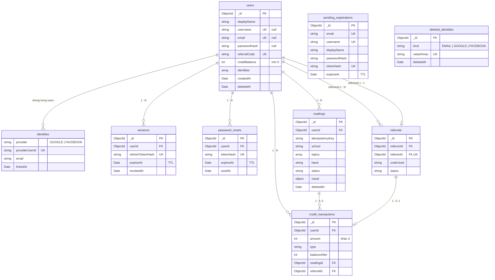

# database-erd — Cơ sở dữ liệu (MongoDB)

MongoDB 7, truy cập qua Mongoose (`@nestjs/mongoose`). Tên collection viết thường kiểu `snake_case`, tên field viết `camelCase`, `_id` là `ObjectId`, thời gian lưu kiểu `Date` (UTC).

Transaction nhiều document cần **replica set**: MongoDB Atlas (kể cả gói free M0) có sẵn; ở local, `docker-compose.yml` chạy MongoDB dạng replica set một node.

## Sơ đồ quan hệ

`deleted_identities` cố ý không có liên kết tới `users`: nó chỉ chứa mã băm, không chỉ ra được tài khoản nào đã bị xoá.

`identities` không phải collection riêng mà là mảng nhúng trong `users`: mỗi user có 0–2 phần tử (Google, Facebook), và luôn được đọc cùng user. Đăng nhập bằng mật khẩu không phải một identity, mà là field `passwordHash` của user.

Mỗi user phải đăng nhập được bằng ít nhất một cách: có `passwordHash`, hoặc có ít nhất 1 identity. Riêng user đã bị xoá (`users:delete`) thì không còn cách nào.

## Đặc tả collection

### users

| Field | Kiểu | Ràng buộc | Ghi chú |
| --- | --- | --- | --- |
| `_id` | ObjectId | | |
| `displayName` | string | bắt buộc, 1–50 ký tự | Người dùng nhập khi đăng ký, hoặc lấy từ Google/Facebook (dài quá thì cắt bớt) |
| `username` | string \| null | lowercase, `^[a-z0-9_]{3,20}$`, unique | Có khi user đăng ký bằng mật khẩu; `null` với user chỉ dùng Google/Facebook |
| `email` | string \| null | lowercase, unique | Luôn là email **đã xác minh** (qua link xác minh hoặc qua Google/Facebook). `null` nếu user chỉ có Facebook không trả email |
| `passwordHash` | string \| null | | argon2id. `null` nếu chưa đặt mật khẩu |
| `passwordUpdatedAt` | Date \| null | | |
| `avatarUrl` | string \| null | | Chỉ có khi lấy từ Google/Facebook |
| `referralCode` | string | 8 ký tự, unique | Mã của chính user để chia sẻ |
| `creditBalance` | int | bắt buộc, validator `minimum: 0` | Cache của sổ cái |
| `identities` | array | 0–2 phần tử | Xem bảng dưới |
| `referralBlocked` | boolean | bắt buộc, mặc định `false` | `true` khi user được tạo lại từ một định danh có trong `deleted_identities`: không được nhập mã giới thiệu. User loại này cũng không có `SIGNUP_BONUS` |
| `createdAt`, `updatedAt` | Date | | Mongoose `timestamps` |
| `deletedAt` | Date \| null | | Đánh dấu tài khoản đã bị xoá bằng script `users:delete` |

Phần tử của `identities`:

| Field | Kiểu | Ghi chú |
| --- | --- | --- |
| `provider` | `GOOGLE` \| `FACEBOOK` | |
| `providerUserId` | string | `sub` của Google / `id` của Facebook |
| `email` | string \| null | Email provider trả về lúc liên kết |
| `linkedAt` | Date | |

Index:
- `{ referralCode: 1 }` unique.
- `{ "identities.provider": 1, "identities.providerUserId": 1 }` unique, để một tài khoản Google/Facebook chỉ thuộc một user.
- `{ email: 1 }` unique, `partialFilterExpression: { email: { $type: "string" } }`: mỗi email đã xác minh thuộc đúng một user; dùng khi gộp tài khoản và khi đăng nhập bằng email.
- `{ username: 1 }` unique, `partialFilterExpression: { username: { $type: "string" } }`.

User đã xoá có `email` và `username` là `null`, nên không chiếm chỗ trong hai index unique trên.

### pending_registrations

Đăng ký bằng email/mật khẩu **chưa xác minh**. User thật chỉ được tạo khi bấm link xác minh. Xem [ADR-0008](adr/0008-email-password-auth.md).

| Field | Kiểu | Ràng buộc | Ghi chú |
| --- | --- | --- | --- |
| `_id` | ObjectId | | |
| `email` | string | bắt buộc, lowercase, unique | Mỗi email chỉ có một đăng ký chờ; đăng ký lại thì ghi đè |
| `username` | string | bắt buộc, lowercase, unique | Giữ chỗ username tới khi hết hạn |
| `displayName` | string | bắt buộc, 1–50 ký tự | |
| `passwordHash` | string | bắt buộc | argon2id |
| `referralCode` | string \| null | | Mã giới thiệu nhập lúc đăng ký; áp dụng khi xác minh |
| `tokenHash` | string | bắt buộc, unique | SHA-256 của token trong link; không lưu token thô |
| `expiresAt` | Date | bắt buộc | 24 giờ sau lần gửi email gần nhất |
| `lastSentAt` | Date | | Dùng cho giới hạn gửi lại |
| `createdAt` | Date | | |

Index:
- `{ email: 1 }` unique, `{ username: 1 }` unique, `{ tokenHash: 1 }` unique.
- TTL `{ expiresAt: 1 }, { expireAfterSeconds: 0 }`: MongoDB tự xoá đăng ký hết hạn, giải phóng username.

Khi đăng ký mới, username phải không trùng **cả** `users.username` lẫn `pending_registrations.username` của email khác.

### password_resets

| Field | Kiểu | Ràng buộc | Ghi chú |
| --- | --- | --- | --- |
| `_id` | ObjectId | | |
| `userId` | ObjectId | bắt buộc, ref `users` | |
| `tokenHash` | string | bắt buộc, unique | SHA-256 của token trong link |
| `expiresAt` | Date | bắt buộc | 1 giờ |
| `usedAt` | Date \| null | | Đánh dấu đã dùng; token chỉ dùng được một lần |
| `createdAt` | Date | | |

Index:
- `{ tokenHash: 1 }` unique.
- `{ userId: 1 }`: huỷ token cũ khi tạo token mới.
- TTL `{ expiresAt: 1 }, { expireAfterSeconds: 0 }`.

### sessions

| Field | Kiểu | Ràng buộc | Ghi chú |
| --- | --- | --- | --- |
| `_id` | ObjectId | | |
| `userId` | ObjectId | bắt buộc, ref `users` | |
| `refreshTokenHash` | string | unique | SHA-256, không lưu token thô |
| `userAgent` | string \| null | | |
| `expiresAt` | Date | bắt buộc | 30 ngày |
| `revokedAt` | Date \| null | | Logout hoặc xoay vòng token |
| `createdAt` | Date | | |

Index:
- `{ refreshTokenHash: 1 }` unique.
- `{ userId: 1 }`.
- TTL `{ expiresAt: 1 }, { expireAfterSeconds: 0 }`: MongoDB tự xoá session hết hạn.

### referrals

| Field | Kiểu | Ràng buộc | Ghi chú |
| --- | --- | --- | --- |
| `_id` | ObjectId | | |
| `referrerId` | ObjectId | bắt buộc, ref `users` | Chủ mã |
| `refereeId` | ObjectId | bắt buộc, ref `users`, **unique** | Mỗi user chỉ nhập mã 1 lần |
| `codeUsed` | string | bắt buộc | |
| `status` | `REWARDED` \| `CAPPED` | bắt buộc | Xem [business-rules.md](business-rules.md) |
| `createdAt` | Date | | |

Index:
- `{ refereeId: 1 }` unique.
- `{ referrerId: 1, createdAt: -1 }`: liệt kê người đã mời và đếm lượt thưởng trong ngày.

### readings

| Field | Kiểu | Ràng buộc | Ghi chú |
| --- | --- | --- | --- |
| `_id` | ObjectId | | |
| `userId` | ObjectId | bắt buộc, ref `users` | |
| `idempotencyKey` | string | bắt buộc, UUID v4 (36 ký tự) | Header `Idempotency-Key` của `POST /readings` |
| `school` | `WESTERN` \| `EASTERN` \| `VEDIC` | bắt buộc | Trường phái người dùng chọn, xem [ai-integration.md](ai-integration.md) |
| `topics` | string[] | bắt buộc, ≥ 1 phần tử | Các mục được bói (đã điền đủ khi người dùng chọn "Bói toàn bộ"), theo thứ tự chuẩn của trường phái |
| `hand` | `LEFT` \| `RIGHT` | bắt buộc | Người dùng chọn; AI không được đổi |
| `status` | `PROCESSING` \| `DONE` \| `FAILED` \| `REJECTED` | bắt buộc | `REJECTED` = ảnh không phải lòng bàn tay |
| `result` | object \| null | | `PalmResult`, theo schema ở [ai-integration.md](ai-integration.md) |
| `rejectReason` | string \| null | | |
| `aiProvider`, `aiModel` | string \| null | | Phục vụ debug, đổi model |
| `errorCode` | string \| null | | |
| `latencyMs` | int \| null | | |
| `createdAt`, `completedAt` | Date | | |
| `deletedAt` | Date \| null | | Người dùng xoá reading: ẩn khỏi API. Document được giữ vì sổ cái tham chiếu tới nó; `result` về `null` |

Reading không có field ảnh: server không lưu ảnh lòng bàn tay ([ADR-0010](adr/0010-no-image-storage.md)).

Index:
- `{ userId: 1, idempotencyKey: 1 }` unique. Reading đã xoá vẫn giữ key, nên gửi lại key đó trả `404`.
- `{ userId: 1, createdAt: -1 }`: trang lịch sử; truy vấn luôn lọc `deletedAt: null`.
- `{ status: 1, createdAt: 1 }`: tìm reading kẹt ở `PROCESSING`.

### credit_transactions

| Field | Kiểu | Ràng buộc | Ghi chú |
| --- | --- | --- | --- |
| `_id` | ObjectId | | ObjectId tăng dần theo thời gian, dùng làm cursor phân trang |
| `userId` | ObjectId | bắt buộc, ref `users` | |
| `amount` | int | bắt buộc, khác 0 | Dương = cộng, âm = trừ |
| `type` | `SIGNUP_BONUS` \| `REFERRAL_BONUS` \| `REFEREE_BONUS` \| `READING_SPEND` \| `READING_REFUND` \| `ADMIN_ADJUST` | bắt buộc | |
| `balanceAfter` | int | bắt buộc | Số dư sau giao dịch |
| `readingId` | ObjectId | ref `readings` | Chỉ có với `READING_*` |
| `referralId` | ObjectId | ref `referrals` | Chỉ có với `REFERRAL_BONUS` (của chủ mã) và `REFEREE_BONUS` (của người nhập) |
| `note` | string | | Bắt buộc với `ADMIN_ADJUST` |
| `createdAt` | Date | | |

Collection này chỉ thêm document mới, không sửa, không xoá.

Index:
- `{ userId: 1, _id: -1 }`: lịch sử credits.
- `{ userId: 1, type: 1 }` unique, `partialFilterExpression: { type: "SIGNUP_BONUS" }`: mỗi user chỉ nhận bonus đăng ký một lần.
- `{ readingId: 1, type: 1 }` unique, `partialFilterExpression: { readingId: { $exists: true } }`: mỗi reading tối đa 1 lần trừ, 1 lần hoàn.
- `{ referralId: 1, type: 1 }` unique, `partialFilterExpression: { referralId: { $exists: true } }`: mỗi referral tối đa 1 lần thưởng chủ mã và 1 lần thưởng người nhập.

### deleted_identities

Định danh của các tài khoản đã bị xoá theo yêu cầu, dùng để tài khoản tạo lại không nhận thưởng lần nữa. Xem [ADR-0009](adr/0009-manual-account-deletion.md).

| Field | Kiểu | Ràng buộc | Ghi chú |
| --- | --- | --- | --- |
| `_id` | ObjectId | | |
| `kind` | `EMAIL` \| `GOOGLE` \| `FACEBOOK` | bắt buộc | |
| `valueHmac` | string | bắt buộc | HMAC-SHA256 (hex) của `kind + ":" + giá trị`, khoá là `IDENTITY_HASH_SECRET`. Giá trị là email chữ thường, Google `sub` hoặc Facebook `id` |
| `deletedAt` | Date | bắt buộc | |

Index:
- `{ valueHmac: 1 }` unique.

Khi tạo user (xác minh email, hoặc lần đầu Google/Facebook), server tính HMAC cho mọi định danh của user đó. Nếu có cái nào nằm trong bảng này: không cộng `SIGNUP_BONUS`, và đặt `referralBlocked = true`. Gắn thêm định danh vào user có sẵn thì không kiểm tra bảng này.

Collection này giữ vô thời hạn; không bao giờ xoá.

## Quản lý index

MongoDB không có migration schema như SQL. Index và validator được khai báo trong schema Mongoose và tạo bằng script `pnpm --filter backend db:sync-indexes`, chạy mỗi lần deploy. Không bật `autoIndex` ở production.
