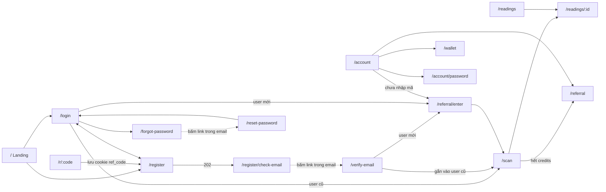

# screens — Màn hình và trạng thái

App thiết kế mobile-first (chiều rộng 360–430 px), chạy dạng PWA. Thanh dưới cùng có 3 tab: **Xem bói**, **Lịch sử**, **Tài khoản**; số credits luôn hiện ở góc trên.

## Sơ đồ điều hướng



## Danh sách màn hình

| Route | Màn hình | Cần đăng nhập | API dùng |
| --- | --- | --- | --- |
| `/` | Landing: giới thiệu, 3 trường phái, nút bắt đầu, ví dụ kết quả | Không | — |
| `/r/:code` | Link giới thiệu: lưu mã vào cookie rồi chuyển `/register` (người theo link thường chưa có tài khoản) | Không | — |
| `/login` | Ô "Email hoặc username" + mật khẩu, nút Đăng nhập; link "Quên mật khẩu?", "Chưa có tài khoản? Đăng ký"; dải "hoặc" + nút Google, nút Facebook; điều khoản | Không | `POST /auth/login`, `POST /auth/google`, `POST /auth/facebook`, `POST /auth/resend-verification` |
| `/register` | Tên hiển thị, username, email, mật khẩu, nhập lại mật khẩu, checkbox đồng ý điều khoản; nút Google/Facebook bên dưới | Không | `POST /auth/register`, `POST /auth/google`, `POST /auth/facebook` |
| `/register/check-email` | "Đã gửi link xác minh tới {email}. Kiểm tra cả thư mục Spam", nút Gửi lại (khoá 60 giây sau mỗi lần bấm) | Không | `POST /auth/resend-verification` |
| `/verify-email` | Tự gọi API khi mở; thành công thì đăng nhập luôn | Không | `POST /auth/verify-email` |
| `/forgot-password` | Ô email, nút Gửi link | Không | `POST /auth/forgot-password` |
| `/reset-password` | Mật khẩu mới + nhập lại | Không | `POST /auth/reset-password` |
| `/referral/enter` | Nhập mã giới thiệu (điền sẵn nếu có), dòng "Nhập mã của bạn bè: bạn nhận 1 credit, bạn bè nhận 2 credits", nút Bỏ qua | Có | `GET /me`, `POST /me/referral` |
| `/scan` | Chọn trường phái → chọn mục muốn bói → chọn tay → chụp ảnh → gửi | Có | `POST /readings` |
| `/readings/:id` | Kết quả bói | Có | `GET /readings/{id}` |
| `/readings` | Lịch sử các lần xem | Có | `GET /readings` |
| `/wallet` | Số dư và lịch sử cộng/trừ credits | Có | `GET /me`, `GET /me/credit-transactions` |
| `/referral` | Mã của tôi, nút copy/chia sẻ, danh sách người đã mời. Câu chia sẻ mẫu: "Nhập mã {CODE} trên PalmSight: bạn được thêm 1 credit xem bói miễn phí" | Có | `GET /me`, `GET /me/referrals` |
| `/account` | Hồ sơ (tên, username, email, các cách đăng nhập đã liên kết, **ID tài khoản** có nút copy), nhập mã giới thiệu (nếu `canEnterCode`), "Đổi mật khẩu" hoặc "Đặt mật khẩu", đăng xuất, link nhỏ "Yêu cầu xoá dữ liệu" tới `/data-deletion`. **Không có nút xoá tài khoản** | Có | `GET /me`, `POST /auth/logout` |
| `/account/password` | Mật khẩu hiện tại, mật khẩu mới, nhập lại | Có | `PUT /me/password` |
| `/privacy`, `/terms`, `/data-deletion` | Chính sách, điều khoản, hướng dẫn xoá dữ liệu. `/data-deletion`: gửi email tới `SUPPORT_EMAIL` từ email của tài khoản (hoặc kèm ID tài khoản nếu không có email); xử lý trong 30 ngày; sau khi xoá, tạo lại tài khoản sẽ không nhận credits khuyến mãi | Không | — |

## Trạng thái từng màn hình chính

### `/scan`

Bước 1 — **Chọn trường phái**: 3 thẻ, mỗi thẻ có tên, một câu mô tả và các mục sẽ được bói. Nội dung lấy từ `READING_SCHOOLS` trong `@palmsight/shared`; app nhớ lựa chọn lần trước.

| Trường phái | Mô tả ngắn trên thẻ |
| --- | --- |
| Chỉ tay phương Tây | Dáng tay 4 nguyên tố, các đường chỉ chính và 7 gò |
| Chỉ tay phương Đông | Dáng tay ngũ hành, Thiên – Nhân – Địa văn, cung bát quái |
| Chỉ tay Ấn Độ | Gò theo 9 hành tinh, đường chính, dấu hiệu đặc biệt |

Bước 2 — **Chọn mục muốn bói**: danh sách checkbox chia hai nhóm, lấy từ `READING_SCHOOLS` và `LIFE_ASPECTS`.

```text
[x] Bói toàn bộ

Đường chỉ & dấu hiệu (theo trường phái phương Đông)
[ ] Dáng tay ngũ hành      [ ] Thiên văn
[ ] Nhân văn               [ ] Địa văn
[ ] Cung bát quái          [ ] Các ngón tay

Khía cạnh cuộc sống
[ ] Tính cách   [ ] Tình cảm   [ ] Sự nghiệp
[ ] Tài chính   [ ] Sức khoẻ   [ ] Gia đạo
```

| Hành vi | Chi tiết |
| --- | --- |
| Mặc định | "Bói toàn bộ" được tích sẵn, các mục bên dưới hiện tích nhưng mờ |
| Bỏ tích "Bói toàn bộ" | Các mục bật lên để chọn từng mục |
| Tích đủ mọi mục bằng tay | Tự chuyển về "Bói toàn bộ" |
| Không có mục nào được tích | Nút **Tiếp tục** bị khoá, hiện "Chọn ít nhất 1 mục" |
| Đổi trường phái | Giữ các khía cạnh đã chọn; mục riêng của trường phái cũ bị bỏ |
| Ghi chú giá | Hiện cố định "Giá 1 credit, dù chọn bao nhiêu mục" |

App nhớ lựa chọn lần trước cho từng trường phái.

Bước 3 — **Chọn tay** trái/phải. Với trường phái phương Đông, hiện gợi ý "Nam xem tay trái, nữ xem tay phải".

Bước 4 — **Chụp ảnh**:

| Trạng thái | Hiển thị |
| --- | --- |
| Chưa cấp quyền camera | Giải thích vì sao cần camera + nút cấp quyền + nút "Chọn ảnh có sẵn" |
| Camera bị từ chối / không hỗ trợ | Chỉ còn nút chọn ảnh (`<input capture="environment">`) |
| Sẵn sàng | Khung viền hình bàn tay, gợi ý "Đủ sáng, xoè tay, lòng bàn tay hướng vào camera" |
| Đã chụp | Xem lại ảnh, nút **Chụp lại** / **Xem bói (−1 credit)**, checkbox đồng ý gửi ảnh cho AI. Chưa tích checkbox thì nút gửi bị khoá; tích rồi thì gửi `aiConsent=true` |
| Đang phân tích | Hoạt ảnh chờ, câu "Đang đọc đường chỉ tay…", khoá nút gửi; có thể mất tới ~40 giây |
| Hết credits (0) | Nút gửi bị khoá; banner "Mời bạn bè nhập mã của bạn để nhận 2 credits" dẫn tới `/referral`. Nếu `canEnterCode = true`, thêm dòng "Có mã của bạn bè? Nhập để nhận 1 credit" dẫn tới `/referral/enter` |
| `402` từ server | Như trên, đồng bộ lại số dư |
| `REJECTED` | "Không nhìn rõ lòng bàn tay" + `rejectReason` + "Đã hoàn 1 credit" + nút chụp lại |
| `AI_UNAVAILABLE` | "Hệ thống bận, đã hoàn 1 credit. Thử lại sau ít phút." Nút thử lại tạo lần xem mới, với `Idempotency-Key` mới |
| Mất mạng / hết 60 giây chưa có response | "Mất kết nối" + nút thử lại; thử lại dùng **cùng** `Idempotency-Key` |
| `409 READING_IN_PROGRESS` | Giữ màn "Đang phân tích", gọi `GET /readings/{readingId}` mỗi 3 giây cho tới khi xong, rồi hiện kết quả như bình thường |

### `/readings/:id`

Thứ tự khối:

1. Ảnh thu nhỏ, nhãn trường phái và nhãn "Toàn bộ" hoặc "N mục".
2. `summary`.
3. Các `sections` đã chọn, theo đúng thứ tự, mỗi mục gồm "Quan sát" và "Ý nghĩa". Ẩn khối này nếu không chọn mục riêng nào.
4. Các khía cạnh cuộc sống đã chọn. Ẩn khối này nếu không chọn khía cạnh nào.
5. Lời khuyên.
6. **Câu miễn trừ.**
7. Nút "Bói thêm mục khác / trường phái khác (−1 credit)": mở lại bước chọn, dùng lại ảnh vừa chụp nếu còn trên máy.
8. Nút chia sẻ (chỉ phần chữ, không kèm ảnh tay) và nút xoá. Bấm xoá → hộp xác nhận → `DELETE /readings/{id}` → quay về `/readings`. Reading đã xoá biến mất khỏi lịch sử và không mở lại được.

UI vẽ `sections` theo cách chung: tiêu đề + quan sát + ý nghĩa. Vì vậy thêm trường phái mới không cần sửa màn hình này.

Nếu `imageQuality = POOR`: banner "Ảnh hơi mờ, kết quả có thể chưa chính xác".

### `/referral/enter`

| Trạng thái | Hiển thị |
| --- | --- |
| Có cookie `ref_code` | Ô mã điền sẵn, nút **Xác nhận** |
| Không có mã | Ô trống, nút **Bỏ qua** nổi bật hơn |
| `201` | "Đã ghi nhận mã của {displayName}. Bạn nhận được {creditsEarned} credit!", cập nhật số credits từ `creditBalance`, rồi chuyển `/scan` |
| `REFERRAL_NOT_ALLOWED` | "Tài khoản này không thể nhập mã giới thiệu". Thực tế màn này bị ẩn khi `canEnterCode = false` |
| `REFERRAL_CODE_NOT_FOUND` | "Mã không tồn tại, kiểm tra lại" |
| `REFERRAL_SELF` | "Bạn không thể nhập mã của chính mình" |
| `REFERRAL_ALREADY_USED` | "Tài khoản đã nhập mã giới thiệu trước đó" |
| `REFERRAL_CYCLE` | "Không thể nhập mã của người bạn đã mời" |

Màn này mở được bất cứ lúc nào từ `/account`, miễn là `GET /me` trả `referral.canEnterCode = true`. Nếu mã đã được áp dụng lúc xác minh email (`canEnterCode = false`), user mới bỏ qua màn này và vào thẳng `/scan`.

### `/login`

| Trạng thái | Hiển thị |
| --- | --- |
| `INVALID_CREDENTIALS` | "Email/username hoặc mật khẩu không đúng" |
| `EMAIL_NOT_VERIFIED` | "Email chưa được xác minh" + nút **Gửi lại email xác minh** (dùng `details.email`) |
| `429` | "Bạn nhập sai quá nhiều lần, thử lại sau {Retry-After} giây" |
| Có query `?reset=1` | Banner "Đã đặt lại mật khẩu, hãy đăng nhập" |

### `/register`

| Trường | Ghi chú |
| --- | --- |
| Tên hiển thị, username, email, mật khẩu | Validate ngay trên form bằng schema Yup dùng chung với API. Gợi ý username: chữ thường, số, `_`, 3–20 ký tự |
| Nhập lại mật khẩu | Chỉ kiểm tra ở client, không gửi lên |
| Mã giới thiệu | Không bắt buộc; điền sẵn từ cookie `ref_code`; gửi lên dưới tên `referralCode`. Gợi ý dưới ô: "Có mã của bạn bè? Nhập để nhận thêm 1 credit" |

| Trạng thái | Hiển thị |
| --- | --- |
| `202` | Chuyển `/register/check-email` |
| `EMAIL_TAKEN` | "Email đã có tài khoản" + link "Đăng nhập" và "Quên mật khẩu?" |
| `USERNAME_TAKEN` | Lỗi dưới ô username: "Username đã có người dùng" |

### `/verify-email`

| Trạng thái | Hiển thị |
| --- | --- |
| Đang gọi API | "Đang xác minh email…" |
| `200`, `isNewUser = true` | "Xác minh thành công, bạn có {user.creditBalance} credits" → `/referral/enter` hoặc `/scan`. Thường là 3, hoặc 4 nếu mã giới thiệu đã được áp dụng; 0 với tài khoản tạo lại sau khi bị xoá |
| `200`, `isNewUser = false` | "Đã thêm đăng nhập bằng mật khẩu cho tài khoản của bạn" → `/scan` |
| `VERIFICATION_TOKEN_INVALID` | "Link không hợp lệ hoặc đã hết hạn" + ô email và nút gửi lại; link "Đã xác minh rồi? Đăng nhập" |

## Nguyên tắc chung

- Số credits cập nhật ngay từ `creditBalance` trong response, không đợi tải lại.
- Mọi thao tác trừ credit hiện rõ "−1 credit" trên nút.
- Mọi lỗi mạng: thông báo tiếng Việt, có nút thử lại. Với `POST /readings`: chỉ dùng **cùng** `Idempotency-Key` khi không nhận được response; đã nhận response thì lần sau dùng key mới.
- Lần đầu mở app sau khi server miễn phí ngủ có thể chậm 30–60 giây: hiện màn chờ "Đang đánh thức máy chủ…" thay vì báo lỗi.
- Văn phong: thân thiện, ngắn gọn, xưng "bạn".
