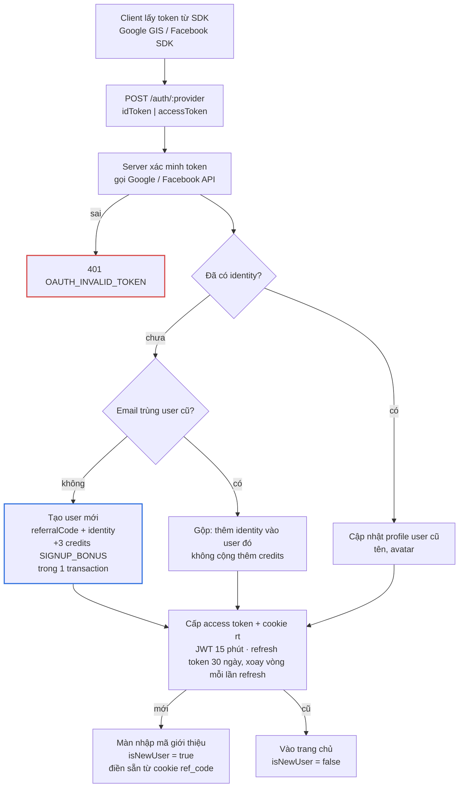
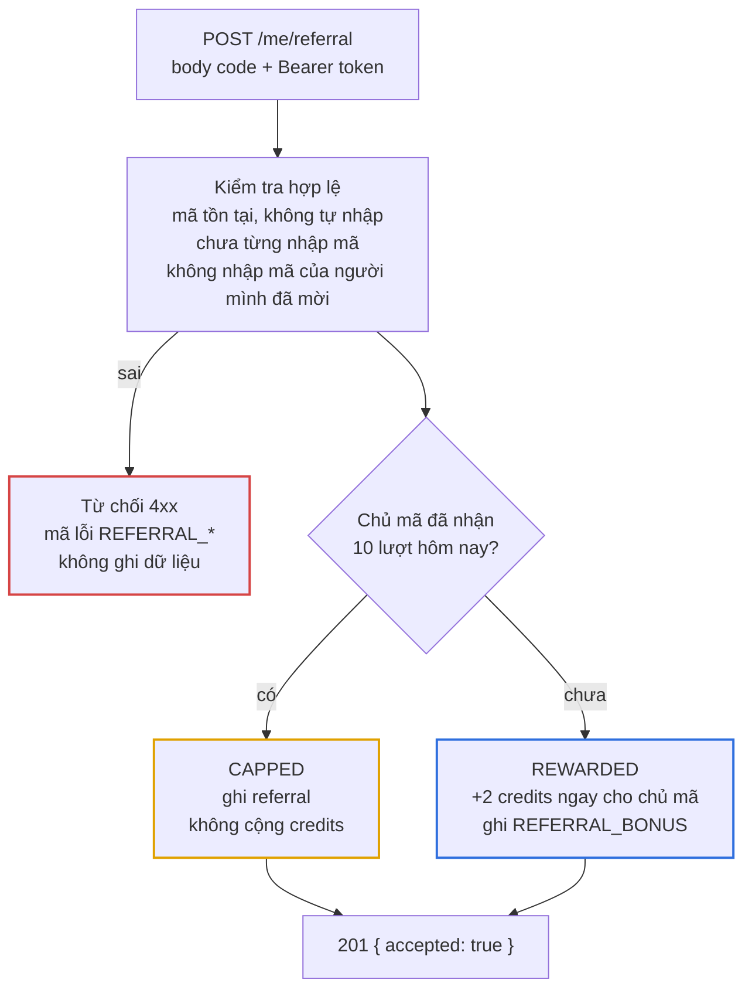
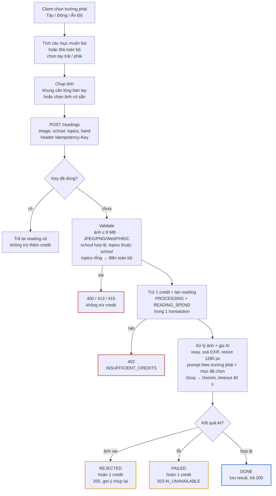

# workflow — Luồng xử lý

## 1. Đăng nhập Google / Facebook

Chỉ nhánh tạo user mới mới cộng 3 credits. Gộp theo email chỉ áp dụng khi provider trả email đã xác minh (Google luôn có, Facebook có thể không), để một người dùng cả hai cách đăng nhập không nhận 6 credits.

## 2. Nhập mã giới thiệu

Ghi referral, cộng credits và ghi sổ cái chạy trong một MongoDB transaction. Unique index trên `referrals.refereeId` chặn việc một người gửi hai request nhập mã cùng lúc.

## 3. Xem bói

Trừ credit **trước** khi gọi AI, để hai request gửi cùng lúc không thể dùng chung một credit cuối cùng. Hoàn credit ghi `READING_REFUND` kèm `readingId`; unique index đảm bảo mỗi reading chỉ được hoàn một lần.

Nếu server chết giữa chừng, reading bị kẹt ở `PROCESSING`. Reading kẹt quá 2 phút được chuyển sang `FAILED` và hoàn credit. Việc này chạy ở hai chỗ, vì server miễn phí có thể đang ngủ:

- Định kỳ mỗi 5 phút trong lúc API đang chạy, và một lần khi API khởi động.
- Khi người dùng mở lịch sử hoặc chi tiết của reading đó.
