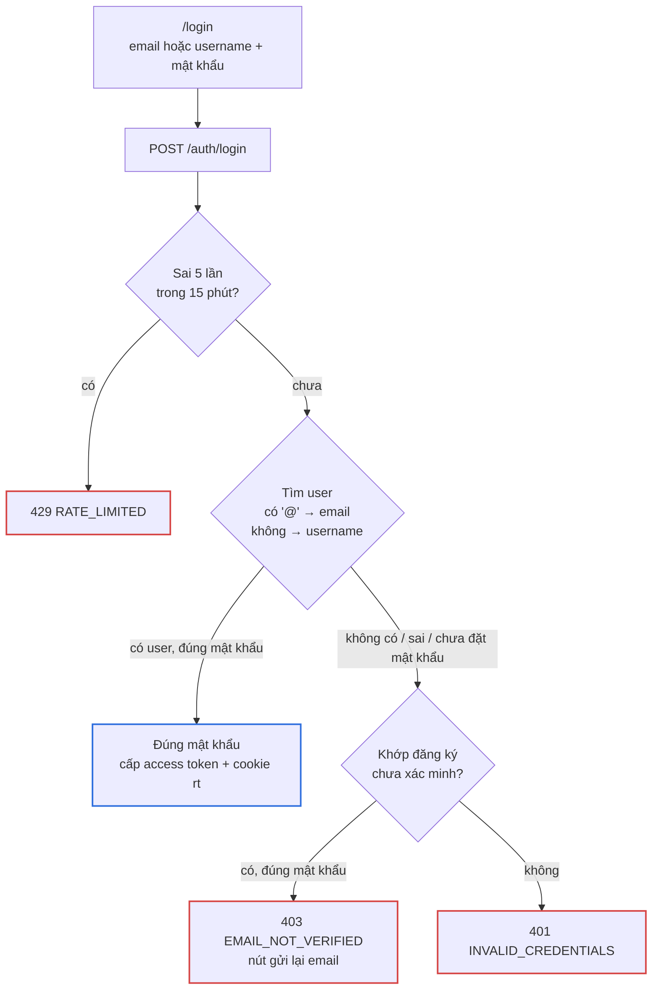
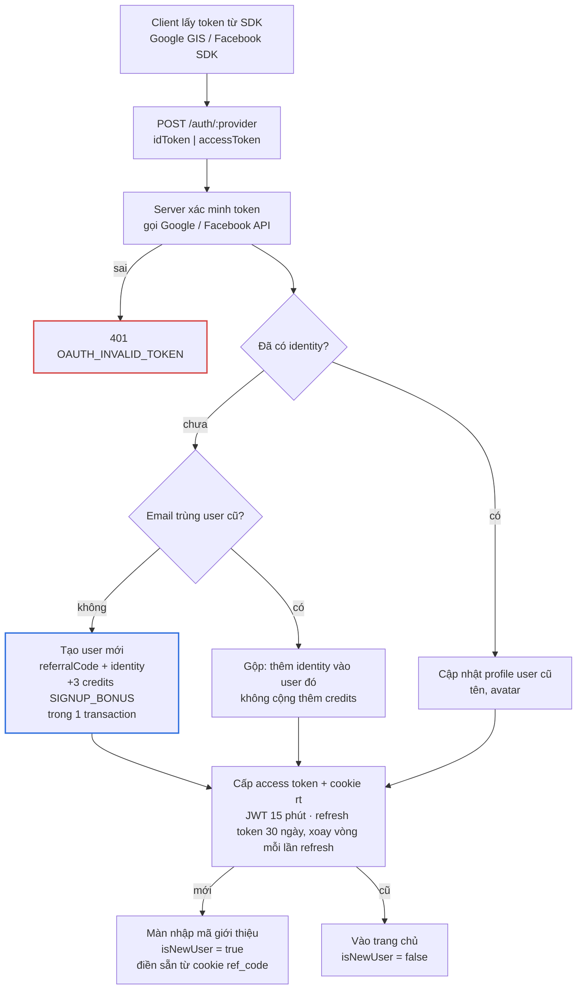
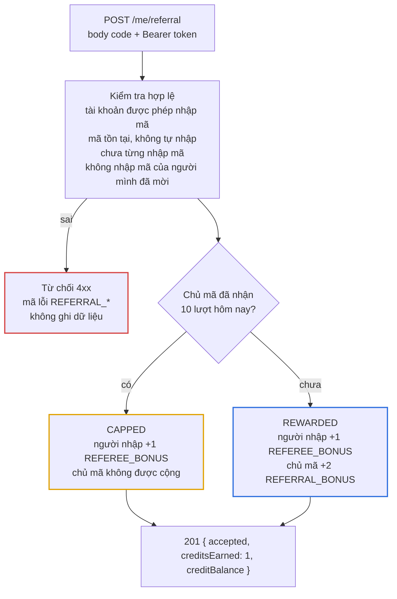
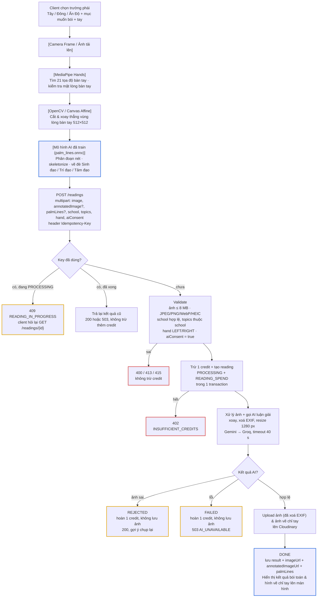

# workflow — Luồng xử lý

## 1. Đăng ký và đăng nhập

Cách chính là email/username + mật khẩu; Google/Facebook là cách đăng nhập phụ. Xem [ADR-0008](adr/0008-email-password-auth.md). Mọi cách đăng nhập thành công đều trả cùng một [response](api-contract.md#response-đăng-nhập-dùng-chung). Nếu `isNewUser = true` thì chuyển tới màn nhập mã giới thiệu.

### 1.1 Đăng ký bằng email và xác minh

```mermaid
flowchart TB
    form["/register<br/>tên hiển thị, username, email, mật khẩu"]
    reg["POST /auth/register"]
    check{"Email / username?"}
    taken["409 EMAIL_TAKEN<br/>hoặc USERNAME_TAKEN"]
    pending["Lưu pending_registrations<br/>hash mật khẩu + hash token<br/>hết hạn sau 24 giờ"]
    mail["Gửi email qua Gmail SMTP<br/>link /verify-email?token=..."]
    wait["202 · màn 'Kiểm tra email'<br/>nút gửi lại"]
    click["Người dùng bấm link<br/>POST /auth/verify-email"]
    valid{"Token hợp lệ?"}
    bad["400 VERIFICATION_TOKEN_INVALID<br/>gợi ý gửi lại email"]
    exists{"Email đã thuộc user<br/>Google/Facebook?"}
    attach["Gắn username + mật khẩu<br/>vào user đó, không cộng credits"]
    create["Tạo user + referralCode<br/>+3 credits SIGNUP_BONUS<br/>trong 1 transaction"]
    login["Xoá đăng ký chờ<br/>cấp access token + cookie rt"]

    form --> reg --> check
    check -->|"email có mật khẩu<br/>hoặc username đã dùng"| taken
    check -->|hợp lệ| pending --> mail --> wait
    wait -.-> click --> valid
    valid -->|"sai / hết hạn / đã dùng"| bad
    valid -->|đúng| exists
    exists -->|có| attach --> login
    exists -->|không| create --> login

    classDef accent stroke:#2f6fde,stroke-width:2px
    classDef bad stroke:#d64545,stroke-width:2px
    class create accent
    class taken,bad bad
```

- Chưa bấm link thì **chưa có user**, nên không đăng nhập được, không có credits, không nhập được mã giới thiệu.
- Đăng ký lại cùng email trước khi xác minh thì ghi đè đăng ký cũ và gửi link mới.
- Hết 24 giờ mà chưa xác minh: MongoDB tự xoá đăng ký chờ (TTL), username được giải phóng.

### 1.2 Đăng nhập bằng mật khẩu



### 1.3 Quên và đặt lại mật khẩu

1. `/forgot-password`: người dùng nhập email → `POST /auth/forgot-password` → luôn `202`, hiện "Nếu email có tài khoản, bạn sẽ nhận được link trong vài phút".
2. Nếu email thuộc một user: server tạo token (1 giờ, dùng một lần), huỷ token cũ, gửi link `/reset-password?token=...`.
3. Bấm link → nhập mật khẩu mới → `POST /auth/reset-password` → `204`. Mọi phiên đăng nhập bị thu hồi; chuyển tới `/login`.

User chỉ dùng Google/Facebook cũng dùng luồng này để đặt mật khẩu lần đầu.

### 1.4 Đăng nhập Google / Facebook



Chỉ nhánh tạo user mới mới cộng 3 credits. Gộp theo email chỉ áp dụng khi provider trả email đã xác minh (Google luôn có, Facebook có thể không), để một người dùng nhiều cách đăng nhập không nhận nhiều lần 3 credits.

"Email trùng user cũ" tính cả user đăng ký bằng mật khẩu. Email của họ đã được xác minh qua link, nên đăng nhập Google cùng email sẽ gắn Google vào tài khoản mật khẩu đó.

## 2. Nhập mã giới thiệu



Ghi referral, cộng credits cho cả hai người và ghi sổ cái chạy trong một MongoDB transaction. Unique index trên `referrals.refereeId` chặn việc một người gửi hai request nhập mã cùng lúc.

## 3. Xem bói & Vẽ đường chỉ tay bằng ONNX

Luồng nhận diện và vẽ chỉ tay trên client kết hợp với luận giải AI và lưu trữ Cloudinary trên server ([ADR-0011](adr/0011-cloudinary-image-storage-and-onnx-palm-lines.md)):



Trừ credit **trước** khi gọi AI, để hai request gửi cùng lúc không thể dùng chung một credit cuối cùng. Hoàn credit ghi `READING_REFUND` kèm `readingId`; unique index đảm bảo mỗi reading chỉ được hoàn một lần.

**Idempotency-Key:**

- Client chỉ gửi lại **cùng** key khi không nhận được response (mất mạng, timeout).
- Đã nhận response bất kỳ thì lần bấm sau dùng key mới. Vì vậy sau `503 AI_UNAVAILABLE`, người dùng bấm thử lại sẽ là một lần xem mới, trừ credit mới (credit cũ đã được hoàn).

Chi tiết ở [api-contract.md](api-contract.md#post-readings).

Nếu server chết giữa chừng, reading bị kẹt ở `PROCESSING`. Reading kẹt quá 2 phút được chuyển sang `FAILED` và hoàn credit. Việc này chạy ở hai chỗ, vì server miễn phí có thể đang ngủ:

- Định kỳ mỗi 5 phút trong lúc API đang chạy, và một lần khi API khởi động.
- Khi người dùng mở lịch sử hoặc chi tiết của reading đó.
